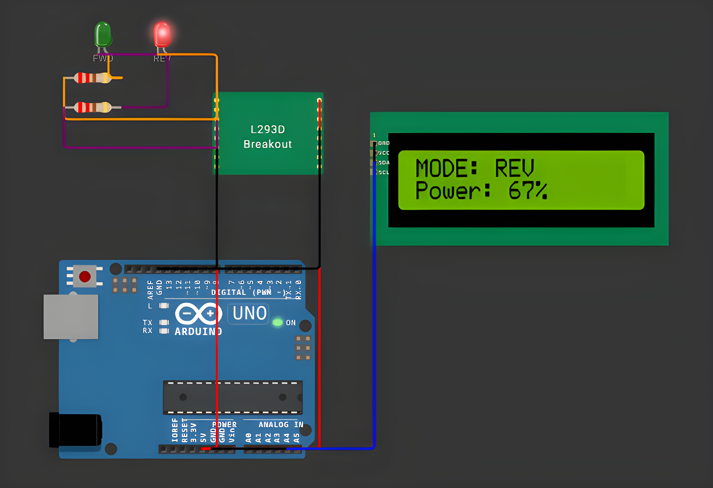

# DC Motor Control System

<table align="center">
  <tr>
    <td align="center">
      
    </td>
  </tr>
</table>

## Overview

DC Motor Control System is an embedded application for Arduino UNO that controls the direction and
speed of a DC motor through an L293D H-bridge driver. The user sends a power value from `-100` to
`+100` over the serial port; the sign selects the direction, the magnitude sets the PWM duty cycle,
and the current state is shown on a 16x2 I²C LCD.

## Features

- **Bidirectional Control**: Positive values run the motor forward, negative values run it in reverse,
  and `0` stops it.
- **PWM Speed Control**: The power percentage (0..100) is mapped to an 8-bit PWM duty cycle (0..255)
  on the driver's enable pin.
- **Serial Commands**: Power values are read from the serial port with `Serial.parseInt()` and
  applied immediately.
- **Default Start-Up Power**: The motor starts at 70% forward as soon as the board boots.
- **LCD Feedback**: Line 1 shows the mode (`MOD: FWD`, `MOD: REV` or `MOD: STOP`), line 2 shows the
  power percentage.
- **Clean Architecture**: Motor driver and LCD driver are separate modules with their own header and
  implementation files, and `main.cpp` only coordinates them.

## Technologies

- **Platform**: Arduino UNO
- **Language**: C++ (Arduino Framework)
- **Motor Driver**: L293D (H-bridge)
- **Libraries**: LiquidCrystal_I2C, Wire
- **Build System**: PlatformIO
- **Simulation**: Wokwi
- **Development Tools**: Visual Studio Code + PlatformIO IDE
- **Version Control**: Git, GitHub

## Project Structure

```
chips/
└── l293d/
    ├── l293d.chip.c
    ├── l293d.chip.json
    ├── l293d.chip.wasm
    └── wokwi-api.h
src/
├── lcd_driver/
│   ├── lcd_driver.cpp
│   └── lcd_driver.h
├── motor_driver/
│   ├── motor_driver.cpp
│   └── motor_driver.h
└── main.cpp
diagram.json
wokwi.toml
platformio.ini
```

## Pin Mapping

| Component | Pin | Action |
|---|---|---|
| L293D EN1 (ENA) | 10 | PWM signal, sets the motor speed |
| L293D IN1 | 7 | Direction input (HIGH = forward) |
| L293D IN2 | 6 | Direction input (HIGH = reverse) |
| LCD I²C (SDA) | A4 | I²C data line |
| LCD I²C (SCL) | A5 | I²C clock line |
| LCD I²C (VCC / GND) | 5V / GND | Power supply |

Driver power: `VCC1 → 5V` (logic), `VCC2 →` motor supply (9–12 V on real hardware, 5V in the
simulation), all `GND` pins to the common ground, motor between `OUT1` and `OUT2`.

| IN1 | IN2 | Result |
|---|---|---|
| HIGH | LOW | Forward |
| LOW | HIGH | Reverse |
| LOW | LOW | Stop |

## Serial Interface

Serial settings: **9600 baud, 8N1**. Send an integer between `-100` and `100`.

| Command | Effect | LCD |
|---|---|---|
| `50` | Forward at 50% | `MOD: FWD` / `Power: 50%` |
| `-75` | Reverse at 75% | `MOD: REV` / `Power: 75%` |
| `100` / `-100` | Full speed forward / reverse | `MOD: FWD` / `MOD: REV` |
| `0` | Motor stopped | `MOD: STOP` / `Power: 0%` |

At start-up the LCD briefly shows `LCD Ready`, then the default state (`MOD: FWD`, `Power: 70%`).

## Configuration

| Parameter | Value | Description |
|---|---|---|
| `ENA` pin | 10 | PWM output to the driver enable pin |
| `IN1` / `IN2` pins | 7 / 6 | Direction outputs |
| Default power | 70% | Applied in `setup()` |
| LCD address | `0x27` | I²C address, 16 columns x 2 rows |
| Serial baud rate | 9600 | Serial monitor speed |

## Simulation

Wokwi has no built-in L293D or DC motor, so the simulation uses:

- a small custom `chip-l293d` (`chips/l293d/`) that models the real L293D pinout: each output follows
  its input while the enable pin is high and is released when it is low, so PWM on the enable pin
  chops the output exactly like the real driver;
- two LEDs in anti-parallel (each with a 220 Ω resistor) between `OUT1` and `OUT2` instead of the
  motor: **green = forward**, **red = reverse**, and the brightness follows the PWM duty cycle.

The custom chip is registered in `wokwi.toml` (`[[chip]]`), so the `chips/` folder must stay in the
project root.

## Resources

- [Wokwi Custom Chips](https://docs.wokwi.com/chips-api/getting-started)
- [L293D Datasheet](https://www.ti.com/product/L293D)
- [Arduino analogWrite Reference](https://www.arduino.cc/reference/en/language/functions/analog-io/analogwrite/)
- [LiquidCrystal_I2C Library](https://github.com/johnrickman/LiquidCrystal_I2C)

## Installation

To build and run the application, follow these steps:

1. **Clone this repository:**
```bash
git clone https://github.com/Constantin-Stamate/dc-motor-control
```

2. **Navigate to the project directory:**
```bash
cd dc-motor-control
```

3. **Open the project in VS Code with the PlatformIO extension installed**

4. **Build and upload to the board (or run the Wokwi simulation):**
```bash
pio run --target upload
```

5. **Open the serial monitor and send power values:**
```bash
pio device monitor -b 9600
```

```
Type a value from -100 to 100 and press Enter -> the motor changes direction and speed,
                                                 and the LCD shows the mode and power
```

## Contributors

**DC Motor Control System** was developed as part of the Internet of Things laboratory works.

- GitHub: [Constantin-Stamate](https://github.com/Constantin-Stamate)
- Email: constantinstamate.r@gmail.com